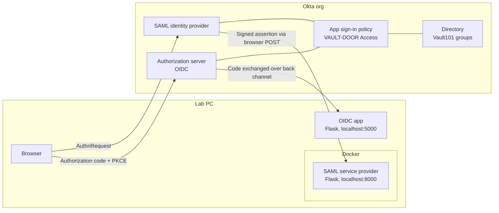

# VAULT-DOOR-iam

Hands-on identity and access management (IAM) lab built on Okta. I stood up a single sign-on (SSO) environment from scratch, integrated one app over OpenID Connect (OIDC) and a second over Security Assertion Markup Language (SAML), enforced phishing-resistant multi-factor authentication (MFA) with group-based policy, tested the full user lifecycle, and mapped the result to NIST SP 800-53.

I work as an incident response analyst in a federal Security Operations Center (SOC). Most of the incidents I handle start with an identity: a phished credential, a suspicious sign-in, an account that kept access it should have lost. This project is the other side of that work. Instead of investigating what happens when access controls fail, I built the controls and tried to break them, to get hands-on practice with the side of identity I usually only see after something has gone wrong.

## Architecture



## What this lab covers

| Area | What I built | Write-up |
| --- | --- | --- |
| Directory | Okta org with role-based groups and test users for standard, privileged, and unauthorized cases | [Lab environment](docs/00-lab-environment.md) |
| OIDC | Web app using the authorization code flow with PKCE (Proof Key for Code Exchange), with a token inspector that explains every claim | [OIDC walkthrough](docs/01-oidc-walkthrough.md) |
| SAML | Hardened Docker container acting as a service provider, validating Okta's signed assertions | [SAML walkthrough](docs/02-saml-walkthrough.md) |
| Access policy | Shared sign-in policy: passkeys for everyone, re-authentication every time for privileged users, default deny | [Policy and lifecycle](docs/03-access-policy-and-lifecycle.md) |
| Lifecycle | Joiner, mover, and leaver tests, including what deprovisioning does and doesn't cut off | [Policy and lifecycle](docs/03-access-policy-and-lifecycle.md) |
| Compliance | Controls mapped to NIST SP 800-53 Rev. 5, with evidence and honest gaps | [Control mapping](docs/04-nist-800-53-mapping.md) |

## Results at a glance

- Unassigned users were refused by Okta before any token or assertion was issued, on both protocols.
- Every sign-in used a phishing-resistant passkey through Windows Hello. The OIDC `amr` claim reported `pop` (proof of possession).
- Offline tests for each app (16 checks each) prove the apps reject tampered, unsigned, expired, replayed, misdirected, and unsolicited responses, each for the specific reason the attack fails.
- Testing surfaced two findings worth knowing in any real deployment:
    - SAML's `AuthnContextClassRef` reported a password sign-in for what was actually a passkey sign-in, because the value is a fixed app setting.
    - Suspending a user at the IdP stops new sign-ins but does not end app sessions already in progress.

## Lab directory

Every access decision in this lab is made by group, never by individual user.

| Group | Purpose |
| --- | --- |
| `Vault101-Residents` | Users allowed into the lab apps |
| `Vault101-Security` | Privileged users held to a stricter sign-on policy |

| Test user | Groups | Role in testing |
| --- | --- | --- |
| Morgan Vale | Residents, Security | Privileged user |
| Jesse Dunn | Residents | Standard user |
| Riley Crane | None | Negative test: denied everywhere |

The Okta super admin account is used for administration only. All app testing runs as the test users above.

## Run it

Requires Python 3, Docker Desktop, and an Okta org configured as described in the write-ups. Copy `.env.example` to `.env` and fill in your values.

| App | Start | Offline test |
| --- | --- | --- |
| OIDC | `py oidc-app/app.py` | `py oidc-app/tests/test_flow.py` |
| SAML | `docker compose up --build` | `docker compose run --rm saml-sp python tests/test_flow.py` |

## Repository layout

```
VAULT-DOOR-iam/
├── docs/                Lab notes, protocol walkthroughs, policy, and control mapping
├── evidence/            Redacted screenshots, organized by part
├── oidc-app/            OIDC test application and offline test
├── saml-sp/             SAML service provider, Dockerfile, and offline test
├── docker-compose.yml   Runs the SAML service provider with container hardening
└── .env.example         Configuration template; real values live in an untracked .env
```

## Secrets handling

No credentials, client secrets, API tokens, or private keys are committed to this repository. Configuration is read from a local `.env` file that `.gitignore` excludes. Screenshots in `evidence/` are reviewed against a redaction checklist before commit. No Enclave spies allowed!

## Progress

- [x] Part 1: Okta org, groups, test users, Docker environment, repository scaffold
- [x] Part 2: OIDC integration
- [x] Part 3: SAML integration
- [x] Part 4: Access policy, lifecycle testing, and NIST SP 800-53 mapping
