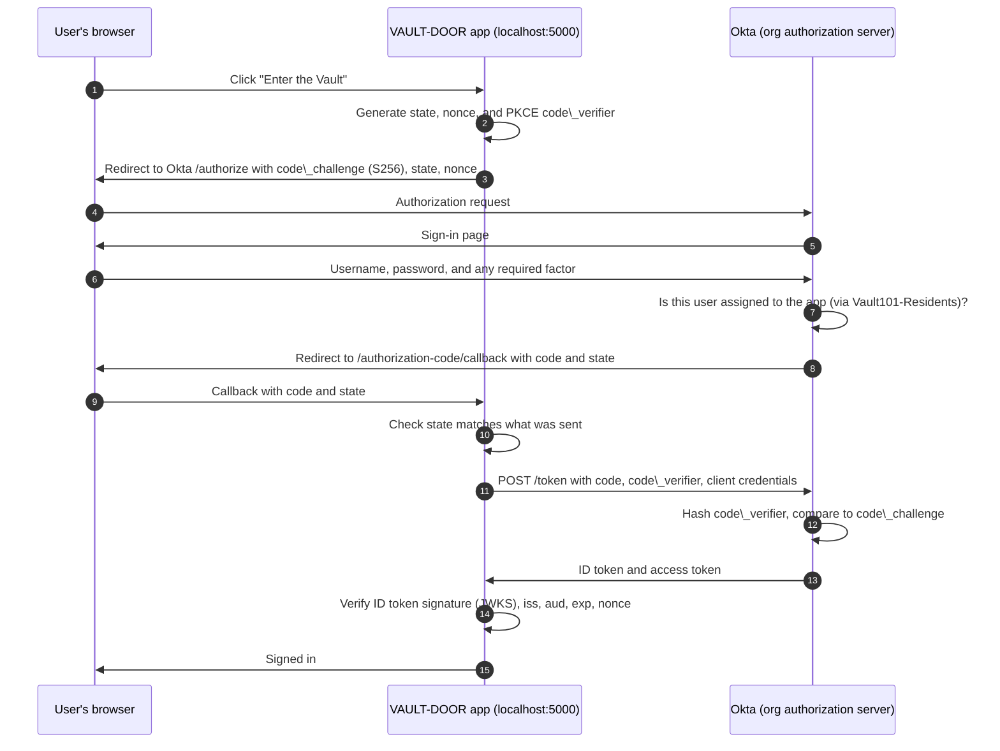

# OIDC Walkthrough

How the VAULT-DOOR test app signs a user in through Okta with OpenID Connect (OIDC), what each step proves, and what I observed testing it.

## The flow

The app uses the authorization code flow with PKCE (Proof Key for Code Exchange). The browser only ever carries a short-lived, single-use code. Tokens travel over a direct back-channel request between the app and Okta.

## What each control prevents

|Control|Where it's checked|Attack it stops|
|-|-|-|
|`state`|App, on callback|Cross-site request forgery (CSRF) that logs a victim into an attacker's session|
|PKCE `code\_verifier` / `code\_challenge`|Okta, at the token endpoint|A stolen authorization code being redeemed by anyone other than the app that requested it|
|`nonce`|App, inside the ID token|Replay of an old or stolen ID token|
|ID token signature|App, against Okta's published keys (JWKS)|Forged or modified tokens|
|`iss` and `aud`|App|Tokens minted by another issuer or for another app being accepted here|
|`exp`|App|Use of expired tokens|
|Client secret|Okta, at the token endpoint|An unregistered client exchanging codes|
|Group-based assignment|Okta, before issuing a code|Users outside `Vault101-Residents` reaching the app at all|

## Okta configuration

|Setting|Value|
|-|-|
|Application type|OIDC, Web Application|
|Grant type|Authorization Code|
|PKCE|Required|
|Sign-in redirect URI|`http://localhost:5000/authorization-code/callback`|
|Sign-out redirect URI|`http://localhost:5000/`|
|Assignment|`Vault101-Residents` group only|
|Groups claim|Filter, name `groups`, starts with `Vault101`|
|Scopes requested|`openid profile email groups`|

## Test results

|Test|User|Expected|Observed|
|-|-|-|-|
|Assigned user signs in|Jesse Dunn|Access granted, `groups` contains `Vault101-Residents`|*Successful authentication*|
|Privileged user signs in|Morgan Vale|Access granted, `groups` contains both Vault101 groups|*Successful authentication*|
|Unassigned user signs in|Riley Crane|Okta refuses, app shows access denied|*Unsuccessful authentication, user not assigned*|
|Sign out|Any|App and Okta sessions both end|*Successful sign off*|
|Offline flow test|None|`py oidc-app/tests/test\_flow.py` reports 16/16|*16/16 reports observed*|

## Notes

- The assertion's AuthnContextClassRef was PasswordProtectedTransport even though the sign-in used a passkey. That value is a fixed setting on the Okta app, not a record of what happened, so it can't be used to prove how a user authenticated. The OIDC `amr` claim was the more accurate signal.

