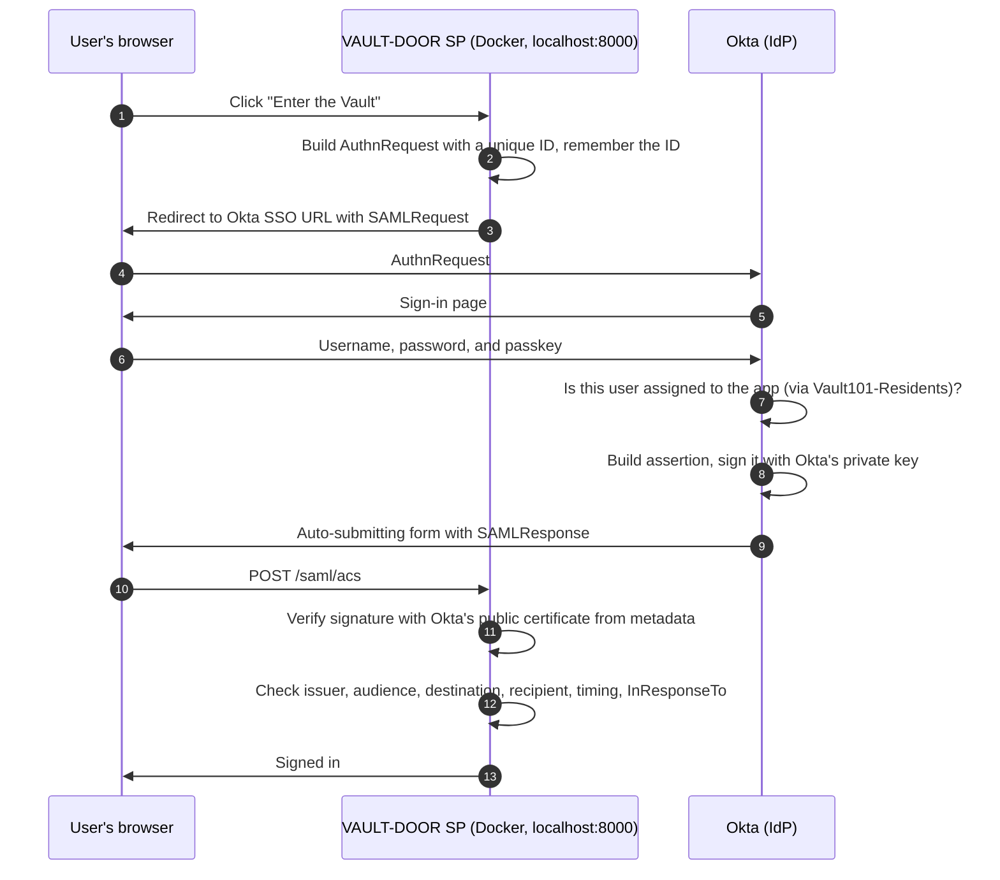

# SAML Walkthrough

How the VAULT-DOOR service provider signs a user in through Okta with SAML (Security Assertion Markup Language) 2.0, what it checks before trusting an assertion, and what I observed testing it.

## The flow

The app runs in a Docker container as the service provider (SP). Okta is the identity provider (IdP). Unlike OIDC, there's no back-channel token exchange: Okta's signed assertion travels to the app through the user's browser, so the signature is the only thing standing between the app and a forged sign-in.

## What each check prevents

| Check | Attack it stops |
| --- | --- |
| Assertion signature | Forged or modified assertions. Changing a single character, like swapping the NameID to another user, breaks the signature |
| Unsigned assertions refused | An attacker posting a hand-written assertion with no signature at all |
| Issuer | Assertions from an IdP this app doesn't trust |
| Audience | Replaying an assertion Okta issued for a different app |
| Destination and Recipient | An assertion captured from another app's endpoint being redirected here |
| NotBefore / NotOnOrAfter | Replaying an old assertion after its short validity window |
| InResponseTo | Unsolicited responses that don't match a request this app actually sent |
| Group-based assignment | Users outside `Vault101-Residents` never get an assertion at all |

## OIDC vs. SAML

| | OIDC (Part 2) | SAML (Part 3) |
| --- | --- | --- |
| Format | JSON Web Tokens (JWT) | XML assertions |
| Signed by | Okta, verified with keys from the JWKS endpoint | Okta, verified with the certificate from IdP metadata |
| How tokens reach the app | Back channel: app trades a code for tokens directly with Okta | Front channel: signed assertion posted through the browser |
| Replay protection | `nonce`, short-lived code, PKCE | `InResponseTo`, short validity window, audience |
| User identifier | `sub` claim | `NameID` |
| Group data | `groups` claim | `groups` attribute statement |
| Typical use | Modern web, mobile, and API access | Enterprise SaaS and legacy web apps |
| Configured by | Client ID, client secret, redirect URIs | Entity ID, ACS URL, certificate exchange via metadata |

## Okta configuration

| Setting | Value |
| --- | --- |
| Application type | SAML 2.0 |
| Single sign-on URL (ACS) | `http://localhost:8000/saml/acs` |
| Audience URI (SP entity ID) | `http://localhost:8000/saml/metadata` |
| Name ID format | EmailAddress |
| Application username | Okta username |
| Attribute statements | `firstName`, `lastName`, `email` |
| Group attribute statement | `groups`, starts with `Vault101` |
| Assignment | `Vault101-Residents` group only |

## Container hardening

| Setting | Why |
| --- | --- |
| Runs as an unprivileged user (UID 10001) | A compromise of the app doesn't hand over root inside the container |
| Read-only root filesystem | Nothing can be written into the app's code at runtime |
| `no-new-privileges` | Blocks privilege escalation through setuid binaries |
| Port bound to `127.0.0.1` only | Nothing else on the network can reach the lab app |
| Secrets passed as environment variables from the untracked `.env` | Nothing sensitive baked into the image |

## Test results

| Test | User | Expected | Observed |
| --- | --- | --- | --- |
| Assigned user signs in | Jesse Dunn | Assertion accepted, `groups` contains `Vault101-Residents` | *Successful login* |
| Privileged user signs in | Morgan Vale | Assertion accepted, `groups` contains both Vault101 groups | *Successful login* |
| Unassigned user signs in | Riley Crane | Okta refuses before issuing an assertion | *Okta refused before password* |
| Offline flow test | None | `docker compose run --rm saml-sp python tests/test_flow.py` reports 16/16 | *16/16 reports observed* |

The offline test signs assertions with a throwaway certificate and confirms the SP rejects tampered, unsigned, expired, wrong-audience, wrong-destination, and unsolicited responses, each with a specific reason.

## Notes

- Sign-out in this app ends only the app's own session. Full SAML single logout (SLO) requires the SP to sign its logout requests with its own certificate, which is out of scope for this lab.
- The SP downloads Okta's metadata at first sign-in. If Okta's signing certificate is ever rotated, restarting the container picks up the new one.
- The assertion's AuthnContextClassRef was PasswordProtectedTransport even though the sign-in used a passkey. That value is a fixed setting on the Okta app, not a record of what happened, so it can't be used to prove how a user authenticated. The OIDC `amr` claim was the more accurate signal.
- Okta refused Riley immediately after the username, before asking for a password. That avoids exposing a password, but Okta's message also confirms the username exists, which is a mild user-enumeration signal.
- The SAML-tracer screenshot shows the full signed response. I assessed it as safe to publish: the certificate is public, and the assertion expired five minutes after issue, is restricted to `localhost:8000`, and is bound to a request ID that was already used, so it can't be replayed.
